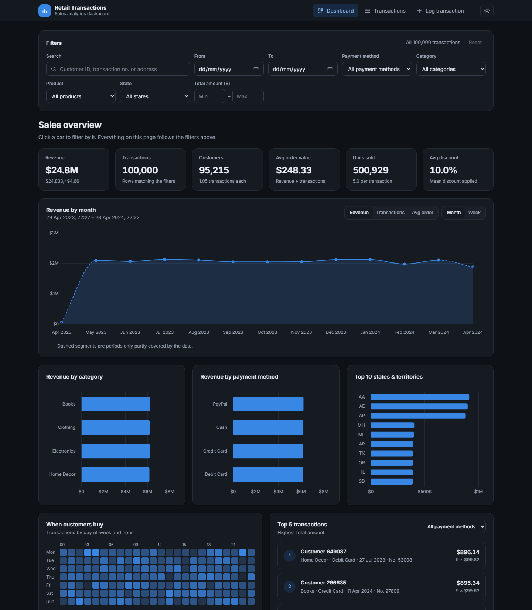
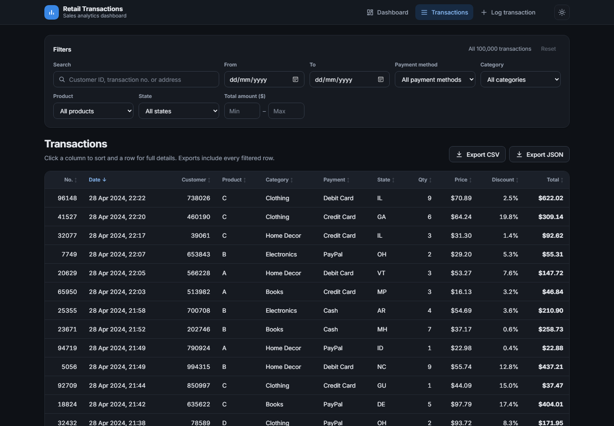
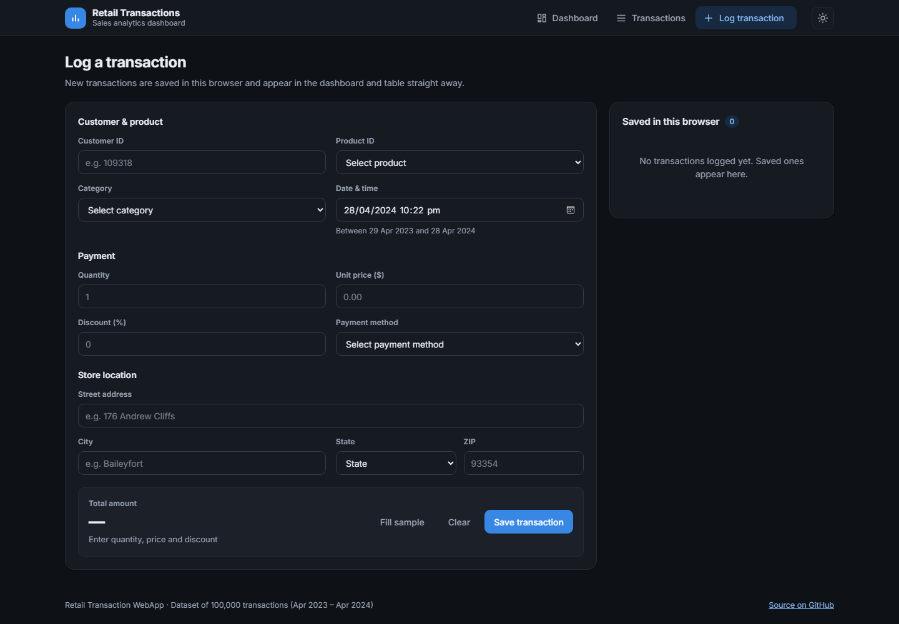

# Retail Transaction WebApp

An interactive sales dashboard for a dataset of **100,000 retail transactions** (April 2023 – April 2024). You can explore KPIs and trends, filter and sort every transaction, export what you see, and log new transactions in the browser.

**Live demo:** https://ethanyap123.github.io/retail-transaction-webapp/

[](https://github.com/EthanYap123/retail-transaction-webapp/actions/workflows/deploy.yml)

Started as my Fundamentals of Programming 2 (FOP2) assignment in Year 1, Semester 2 of the Diploma in Information Technology at Singapore Polytechnic, then rebuilt in Year 2 into a complete, deployable app.



## Features

- **KPI dashboard**: revenue, transactions, unique customers, average order value, units sold and average discount, all recalculated for the current filters.
- **Trend chart**: revenue, transaction count or average order value by month or by week. Periods the data only partly covers are drawn dashed, so a half-month doesn't look like a sales drop.
- **Breakdowns**: revenue by product category, by payment method and for the top 10 states. Click a bar to filter by it.
- **"When customers buy" heatmap**: transactions by day of week and hour.
- **Top 5 transactions**: the largest sales, optionally for one payment method, shown with the `<transaction-card>` web component.
- **Transactions table**: sort by any column, page through all 100,000 rows, and click a row for the full record.
- **Shared filters**: search by customer ID, transaction number or address, plus date range, payment method, category, product, state and amount range. The dashboard and table always show the same rows.
- **CSV / JSON export**: download the filtered rows. The CSV has the same columns and date format as the original dataset.
- **Transaction logging**: a validated form for new transactions. The total is calculated live, and saved logs are kept in `localStorage`. They show up in the dashboard and table straight away, marked "New", and can be exported or deleted.
- **Light and dark mode**, responsive down to phone width, and keyboard accessible (sortable headers, focusable rows and heatmap cells, labelled controls).

| Transactions | Log a transaction |
| --- | --- |
|  |  |

## Tech stack

- **Frontend:** HTML, CSS (custom properties, grid) and vanilla JavaScript ES modules, with no framework and no build step. [Chart.js](https://www.chartjs.org/) draws the charts and a custom element (Web Components) draws the transaction cards.
- **Backend:** Node.js with Express and `csv-parse`. It serves the original REST endpoints and the web app.
- **Deployment:** GitHub Actions builds the dataset and publishes `webapp/` to GitHub Pages.

## Project structure

```
server/
  data/retailTransaction.csv   source dataset (100,000 rows)
  lib/dataset.js               CSV reading, grouping and packing (shared)
  scripts/build-data.js        writes webapp/data/transactions.json
  server.js                    Express API + static hosting of the web app
webapp/
  index.html                   page layout
  css/styles.css               design tokens, light/dark themes, responsive rules
  js/app.js                    entry point: navigation, theme, dialog, data flow
  js/data.js                   loads the dataset, manages localStorage logs
  js/filters.js                shared filter bar
  js/dashboard.js              KPIs, charts, heatmap, top transactions
  js/table.js                  sortable, paginated table and export
  js/form.js                   log form with validation
  js/export.js                 CSV / JSON export
  js/charts.js                 Chart.js wrappers
  js/components/transaction-card.js   <transaction-card> web component
```

## Running locally

You need [Node.js](https://nodejs.org/) 18 or newer.

```bash
cd server
npm install
npm start
```

Then open http://localhost:8081. The server loads the CSV, serves the web app and exposes the API.

To run the web app as a static site without the server (this is how GitHub Pages runs it):

```bash
cd server
npm run build:data
cd ../webapp
python -m http.server 8000
```

Then open http://localhost:8000. The app uses ES modules, so open it through a web server rather than by double-clicking `index.html`.

## Dataset integration

`server/data/retailTransaction.csv` has 11 columns:

`no, customerID, productID, quantity, price, transactionDate, paymentMethod, storeLocation, productCategory, discountAppliedInPercentage, totalAmount`

- `totalAmount` = `quantity × price × (1 − discount ÷ 100)`. This holds for every row, and new logs are calculated the same way.
- `transactionDate` uses `M/D/YYYY H:MM` with no timezone, so the app treats dates as plain wall-clock times and never shifts them.
- `storeLocation` is a two-line US address. The app reads the state code from the last line for the state filter and chart.

The browser needs the whole dataset for the charts and filters, so `lib/dataset.js` packs it into a column-based JSON file (`data/transactions.json`). Repeated text values become lookup indexes, money is stored in cents and dates as minutes, which makes the file about 3.6 MB compressed. The Express server sends this file from memory. `npm run build:data` writes the same file to disk for static hosting. It is generated from the CSV, so it is not committed.

Logged transactions are stored in `localStorage` with the same field names and formats as the CSV, so exporting them gives rows that match the original dataset. New logs must fall within the dataset's date range so trends stay comparable.

## API endpoints

The original assignment endpoints are unchanged (numbers are now returned as numbers):

| Endpoint | Returns |
| --- | --- |
| `GET /retailData5` | First 5 records |
| `GET /paymentMethod` | `[label, slug]` pairs, e.g. `["Credit Card", "credit-card"]` |
| `GET /productCategory` | `[label, slug]` pairs |
| `GET /byPaymentMethod/:slug` | All records for a payment method, e.g. `/byPaymentMethod/credit-card` |
| `GET /byProductCategory/:slug` | All records for a category, e.g. `/byProductCategory/home-decor` |
| `GET /data/transactions.json` | The whole dataset in the packed format used by the web app |
| `GET /health` | Plain-text health check |

## What changed from the original assignment

- Fixed the data loading: the CSV path now works from any folder, `quantity`, `no` and `customerID` are parsed as numbers, and a failed load stops the server with a clear message instead of leaving it half-started.
- Removed the hard-coded `http://localhost:8081` API address, so the same frontend works with the server or as a static site.
- Read payment methods from the data instead of a hard-coded list, and escaped all data before inserting it into the page.
- Removed unused dependencies (`fs`, plus `node-fetch` and `readline-sync` left over from CA1).
- Split the single inline script into modules and rebuilt the UI with the dashboard, table, filters, export and logging features above.

## Author

**Ethan Yap**, Diploma in Information Technology, Singapore Polytechnic
[Portfolio](https://ethanyap123.github.io/portfolio/) · [GitHub](https://github.com/EthanYap123)

## License

[MIT](LICENSE)
